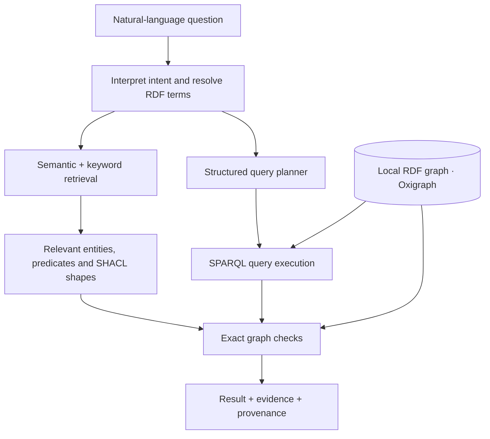

# Graph Verity

**Ask naturally. Verify against the graph.**

Graph Verity is a **local-first semantic search and question-answering engine for RDF knowledge graphs**. It is designed to turn natural-language questions into results backed by actual RDF facts—not just plausible text.

> **Status: Planning / early development.** The architecture and implementation plan are documented, but the engine, API and CLI described below are not yet available.

## The idea

A typical search engine finds matching words. A semantic search engine finds similar meaning. A **knowledge graph** can tell us something more useful: *how things are related*.

Imagine an RDF graph containing organizations and contracts:

```text
Oslo Municipality ──owns──────────> North Energy AS
North Energy AS ────supplies───────> Public Agency
North Energy AS ────hasContract────> Contract A (active)
North Energy AS ────hasContract────> Contract B (active)
North Energy AS ────hasContract────> Contract C (active)
```

Now ask:

> **Which municipality-owned companies have at least three active contracts?**

Answering requires understanding *owned by*, following the correct edges, counting contracts and checking the underlying data. Graph Verity aims to do that work for you, while keeping the result inspectable.

## How it works



Graph Verity separates **relevance** from **correctness**:

- **Find mode** ranks likely entities, relations and SHACL shapes. Useful when you do not know where to start.
- **Ask mode** plans and executes supported structured queries, including joins, filters, counts and comparisons.
- **Verification** uses RDF/SPARQL and supported SHACL constraints to check claims and provide supporting graph facts.

A high vector similarity score is **not proof**. And the top 20 retrieved entities are not necessarily *all* entities matching a structured condition: complete answers require an exhaustive query within an explicitly defined graph scope.

## What makes it different?

| Capability | Why it matters |
| --- | --- |
| **Natural language → RDF** | Explore graphs without writing SPARQL for every question. |
| **Relationship-aware retrieval** | Distinguish “owns” from “supplies to,” even when labels are similar. |
| **Exact query execution** | Let SPARQL handle counts, comparisons, joins and graph traversal. |
| **SHACL awareness** | Find rules and detect constraint violations without mistaking similarity for conformance. |
| **Multilingual** | Initially target Norwegian questions over Norwegian- and English-labeled graphs. |
| **Traceable evidence** | Associate answers with RDF terms, graph snapshots and source provenance. |
| **Local-first runtime** | Aim for one Rust process with local models, indexes and RDF storage; no hosted AI inference needed. |

## Architecture

The planned first version deliberately starts simple:

| Layer | Planned technology | Purpose |
| --- | --- | --- |
| RDF store | [Oxigraph](https://github.com/oxigraph/oxigraph) | Store quads and execute SPARQL in-process. |
| Text understanding | EmbeddingGemma 2 | Encode questions and textual RDF descriptions. |
| Runtime inference | ONNX Runtime + Rust `ort` | Run the model locally on CPU. |
| Retrieval | 256-dimensional vectors + BM25 | Combine meaning with exact identifiers and names. |
| Formal validation | SPARQL + supported SHACL subset | Test actual graph facts and constraints. |
| Query planning | Typed restricted query representation | Compile supported multi-part questions into safe, read-only SPARQL. |
| Optional graph learning | CompGCN / R-GCN | Train relation-aware embeddings offline *if benchmarks justify them*. |
| Offline training | Python + PyTorch Geometric | Prepare data, train and export models; not needed for serving. |

**Graph learning is optional.** We will ship and measure a text-first retrieval baseline before attempting a neural graph encoder. We will only adopt CompGCN if it improves relational-question Recall@10 by at least **10 absolute percentage points** over that baseline, without unacceptable regressions or complexity.

### What about SHACL?

[SHACL](https://www.w3.org/TR/shacl/) defines constraints for RDF data, such as required properties, datatypes and cardinality. Graph Verity will index shapes for discovery and validate explicitly supported constraints with established tooling and conformance tests. It will **not claim full SHACL support** before that support has been implemented and verified.

A node that *violates* a shape can still be relevant—for example, when asking for data-quality problems.

## Planned API (illustrative, not implemented)

Exploratory retrieval:

```http
POST /v1/search
Content-Type: application/json

{
  "question": "Who owns North Energy?",
  "k": 10
}
```

Structured question answering:

```http
POST /v1/ask
Content-Type: application/json

{
  "question": "Which suppliers have at least three active contracts with Oslo Municipality?"
}
```

The planned response includes relevant RDF identifiers, verifiable evidence, the graph snapshot used, and whether the answer is exhaustive *within its stated scope*. These examples demonstrate the intended interface, **not a working endpoint**.

## Roadmap

- [ ] **0. Benchmark:** Choose an RDF dataset, gold questions and target hardware.
- [ ] **1. RDF ingestion:** Import into Oxigraph, retain provenance and build a vocabulary registry.
- [ ] **2. Text-first search:** Run EmbeddingGemma locally; combine vector retrieval and BM25.
- [ ] **3. Verification:** Check RDF facts and a pinned, tested SHACL subset.
- [ ] **4. Query planning:** Support safe multi-condition queries with joins, counts and filters.
- [ ] **5. Graph learning:** Evaluate CompGCN and R-GCN against the baseline.
- [ ] **6. Hardening:** Add versioned artifacts, incremental updates, regression tests and benchmarks.

The detailed engineering design—including milestones, acceptance criteria, safety boundaries and evaluation methodology—is in **[docs/implementation-plan.md](docs/implementation-plan.md)**.

## Repository layout (planned)

```text
graph-verity/
├── README.md
├── LICENSE
├── docs/
│   └── implementation-plan.md
├── crates/          # Rust serving engine
├── ml/              # Offline model training
├── tests/           # RDF, SHACL and retrieval fixtures
└── configs/         # Runtime and experiment configuration
```

There is **no installation or quick-start command yet**. Instructions will be added with the first runnable milestone.

## Limits and correctness

Graph Verity will never equate an embedding match with RDF truth. RDF graphs can be incomplete: a missing triple does not automatically prove a negative assertion. The engine must distinguish unsupported questions, ambiguous plans, unverified matches and formally checked answers. Complete structured results are possible only relative to an explicit graph scope and query semantics.

## Contributing

This is an early-stage project. Feedback and contributions on RDF use cases, Norwegian/English search benchmarks, SHACL conformance, ontology resolution, safe SPARQL planning and local Rust inference are welcome. Please read the [implementation plan](docs/implementation-plan.md) and open an issue to discuss substantial changes before starting them.

## License

See [LICENSE](LICENSE) for repository terms. Model weights, datasets and third-party dependencies may carry separate license obligations.

---

**Graph Verity** · *Ask naturally. Verify against the graph.*
